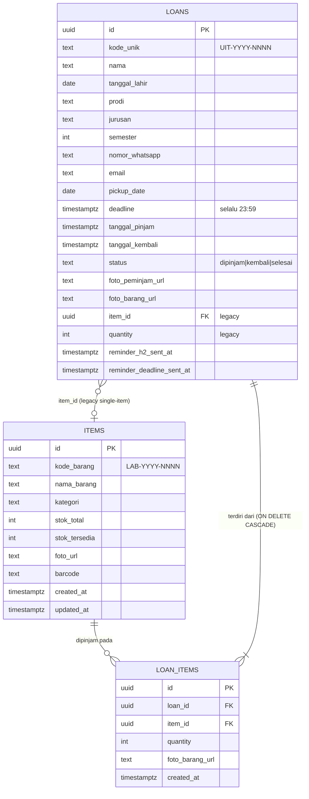
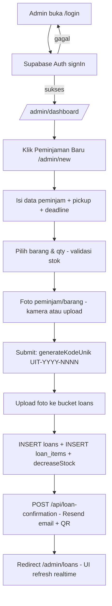
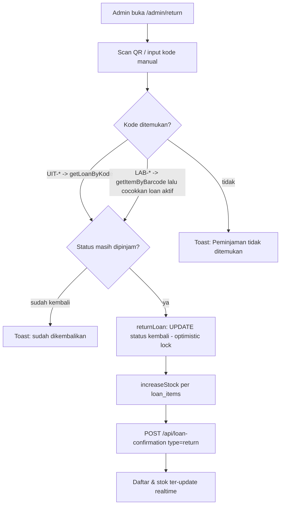
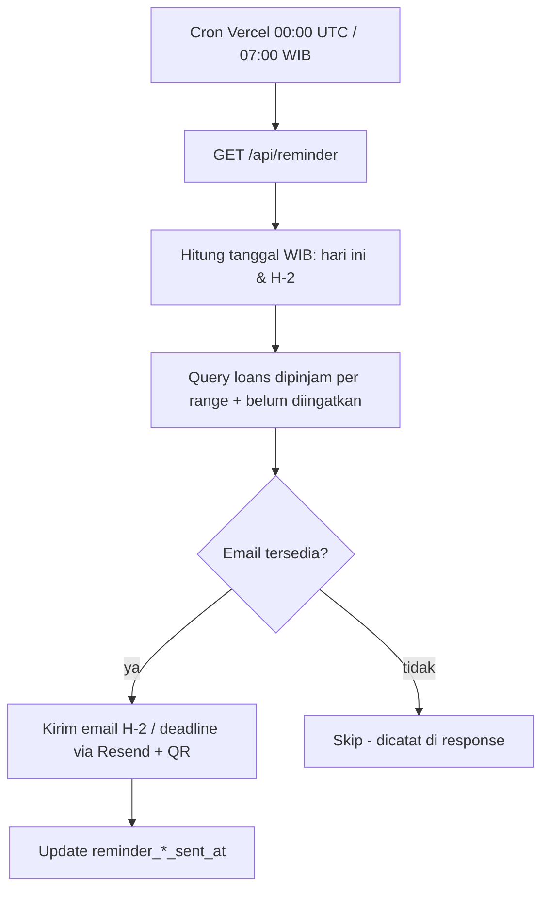

# CAPSTONE PROJECT DOCUMENTATION — UNIMUS INVENTRACK (UIT)

> Dokumen ini disusun berdasarkan analisis langsung terhadap seluruh source code, konfigurasi, dan struktur folder project `unimus-inventrack`. Seluruh pernyataan mengacu pada implementasi nyata yang ditemukan di kode. Informasi yang tidak dapat diverifikasi dari source code ditandai **perlu dikonfirmasi**, fitur yang belum selesai ditandai **PARTIALLY IMPLEMENTED**, dan kode yang terdeteksi tidak dipakai ditandai **UNUSED/UNCONFIRMED**.

---

## 1. Identitas Project

| Aspek | Keterangan |
| --- | --- |
| **Nama project** | UNIMUS Inventrack (UIT) — *Smart Laboratory Inventory* (versi UI mencantumkan "UIT v2.0") |
| **Tujuan utama** | Sistem informasi berbasis web untuk mengelola inventaris barang laboratorium dan proses peminjaman/pengembalian barang secara digital dan *real-time* |
| **Permasalahan yang diselesaikan** | Pencatatan peminjaman barang laboratorium yang manual/berbasis buku diganti dengan sistem digital terintegrasi (stok otomatis, QR code, bukti cetak, notifikasi email otomatis) — sesuai deskripsi pada `README.md` dan metadata `app/layout.tsx` |
| **Target pengguna** | (1) **Admin laboratorium** — pengguna terautentikasi yang mengelola barang dan peminjaman; (2) **Peminjam/mahasiswa** — subjek data peminjaman (tidak memiliki akun sendiri di sistem); (3) **Pengunjung publik (guest)** — dapat melihat katalog, riwayat peminjaman, dan scan QR |
| **Platform** | Aplikasi web *responsive* (Next.js), dapat diakses dari browser desktop maupun ponsel (fitur kamera untuk scan dan ambil foto dirancang untuk perangkat dengan kamera) |
| **Teknologi utama** | Next.js 13.5.1 (App Router) + React 18 + TypeScript, Supabase (Database, Auth, Storage, Realtime), Tailwind CSS + shadcn/ui (Radix UI), Resend (email), html5-qrcode (scanner), qrcode (generator QR) |

---

## 2. Latar Belakang

Berdasarkan `README.md` dan implementasi fitur yang ditemukan, project ini dibangun untuk **menggantikan pencatatan manual berbasis buku** pada pengelolaan barang laboratorium Universitas Muhammadiyah Semarang (UNIMUS). Kesimpulan ini didukung oleh:

1. Adanya modul peminjaman lengkap (form data peminjam mahasiswa: nama, tanggal lahir, prodi, jurusan, semester, WhatsApp, email) pada `app/admin/new/page.tsx`.
2. Adanya kode unik peminjaman otomatis bernilai serial (`UIT-YYYY-NNNN`) dan kode barang (`LAB-YYYY-NNNN`) pada `lib/loans.ts:87` dan `lib/items.ts:41` — ciri khas migrasi dari pencatatan buku besar ke sistem bernomor.
3. Adanya **bukti peminjaman yang dapat dicetak** (`app/admin/print/[kode]/page.tsx`), yang merepresentasikan pengganti formulir/buku cetak manual.
4. Adanya sistem **reminder H-2 dan hari deadline via email** (`app/api/reminder/route.ts`) — menyelesaikan masalah peminjam yang lupa batas pengembalian, yang tidak mungkin dilakukan secara manual.

Detail historis lengkap (skripsi/latar belakang formal, nama laboratorium spesifik) **perlu dikonfirmasi** karena tidak terdokumentasi di dalam source code.

---

## 3. Tujuan Project

### 3.1 Tujuan Umum

Mewujudkan sistem informasi laboratorium yang memungkinkan pencatatan, pemantauan, dan pengelolaan peminjaman barang secara digital, transparan, dan *real-time* bagi admin laboratorium dan sivitas kampus.

### 3.2 Tujuan Khusus (terverifikasi dari kode)

1. **Digitalisasi katalog barang** — CRUD barang dengan kode otomatis, kategori, stok total/tersedia, foto, dan field barcode (implementasi: `lib/items.ts`, `components/admin/ItemsCatalog.tsx`).
2. **Otomatisasi pengelolaan stok** — stok berkurang saat pinjam dan bertambah saat kembali tanpa perhitungan manual (`decreaseStock`/`increaseStock` di `lib/items.ts`, `createLoanWithItems`/`returnLoan` di `lib/loans.ts`).
3. **Identifikasi digital berbasis QR** — setiap peminjaman memiliki kode unik yang divisualisasikan sebagai QR code untuk pencarian/detail dan verifikasi pengembalian (`BarcodeScannerModal`, `QRCodeDisplay`, halaman `/detail/[kode]`).
4. **Notifikasi otomatis** — email konfirmasi peminjaman/pengembalian dan reminder H-2 serta hari deadline (`app/api/loan-confirmation`, `app/api/reminder`, `vercel.json` cron).
5. **Transparansi publik** — halaman publik menampilkan katalog barang tersedia, statistik, dan riwayat peminjaman secara *real-time* (`app/page.tsx`).
6. **Bukti transaksi fisik** — halaman cetak bukti peminjaman ber-QR (`app/admin/print/[kode]/page.tsx`).
7. **Keamanan akses admin** — proteksi route `/admin/*` dengan Supabase Auth + middleware, auto-logout karena inaktivitas (`middleware.ts`, `contexts/AuthContext.tsx`).

---

## 4. Fitur Sistem

### 4.1 Autentikasi Admin (LOGIN) — *IMPLEMENTED*

| Aspek | Keterangan |
| --- | --- |
| Fungsi | Login admin dengan email + password via Supabase Auth (credential-based) |
| Pengguna | Admin |
| Alur | `/login` → `signIn()` (`lib/auth.ts:4`) → Supabase Auth → redirect `/admin/dashboard` → middleware memvalidasi session di setiap request `/admin/*` |
| File | `app/login/page.tsx`, `lib/auth.ts`, `middleware.ts`, `contexts/AuthContext.tsx` |
| Database/API | Supabase Auth (`signInWithPassword`); tidak ada halaman register (akun admin dibuat di dashboard Supabase — **perlu dikonfirmasi**) |

### 4.2 Auto-Logout / Session Timeout — *IMPLEMENTED (dengan catatan)*

| Aspek | Keterangan |
| --- | --- |
| Fungsi | Deteksi inaktivitas 60 menit; warning 5 menit sebelum logout; logout otomatis |
| File | `contexts/AuthContext.tsx:16-17,69-85`; banner peringatan di `components/admin/AdminHeader.tsx:52-67` |
| Catatan | Redirect auto-logout ke `/login?timeout=true`, tetapi **halaman login tidak membaca parameter `timeout`** dan tidak menampilkan pesan "sesi berakhir" → **PARTIALLY IMPLEMENTED** |

### 4.3 Dashboard Admin — *IMPLEMENTED*

| Aspek | Keterangan |
| --- | --- |
| Fungsi | Statistik total/dipinjam/dikembalikan/peminjaman hari ini/terlambat, jumlah barang tersedia, daftar 8 peminjaman terbaru, panel peminjaman terlambat (top 5), tombol aksi cepat |
| Pengguna | Admin |
| Alur | Buka `/admin/dashboard` → `getAllLoans()` + `getAllItems()` + `getItemsStatistics()` → render; subscribe realtime Supabase pada tabel `loans` dan `items` untuk refresh otomatis |
| File | `app/admin/dashboard/page.tsx` |
| Database | Query SELECT pada `loans`, `items` (via `lib/loans.ts`, `lib/items.ts`) |

### 4.4 Manajemen Katalog Barang (CRUD) — *IMPLEMENTED*

| Aspek | Keterangan |
| --- | --- |
| Fungsi | Tambah, edit, hapus, cari, dan filter barang (kategori fixed: Elektronik, Alat Ukur, Bahan Kimia, Alat Laboratorium, Perlengkapan, Lainnya; filter stok tersedia/kosong) |
| Pengguna | Admin (halaman `/admin/items`) |
| Alur | "Tambah Barang" → `generateKodeBarang()` menghasilkan `LAB-YYYY-NNNN` → isi form (nama, deskripsi, kategori, stok, barcode manual, foto) → `createItem()` (stok_tersedia disamakan dengan stok_total) → upload foto ke bucket `items` → tabel diperbarui realtime |
| File | `app/admin/items/page.tsx`, `components/admin/ItemsCatalog.tsx`, `lib/items.ts`, `lib/upload.ts` |
| Database | INSERT/UPDATE/DELETE/SELECT tabel `items`; Storage bucket `items` |
| Logika penting | Auto-sync `stok_tersedia` ketika `stok_total` diubah (`lib/items.ts:136-151`) |

### 4.5 Peminjaman Multi-Item — *IMPLEMENTED*

| Aspek | Keterangan |
| --- | --- |
| Fungsi | Admin mencatat peminjaman satu atau beberapa jenis barang sekaligus (dengan jumlah unit per barang) untuk satu peminjam |
| Pengguna | Admin (halaman `/admin/new`) |
| Alur | Isi data peminjam (nama, TTL, prodi, jurusan, semester, WhatsApp, email, tanggal pengambilan, deadline) → pilih barang via `ItemSelect` + atur quantity → *cart* multi-item (validasi stok per item) → (opsional) foto peminjam/barang via kamera atau upload → submit → `generateKodeUnik()` (`UIT-YYYY-NNNN`) → upload foto ke bucket `loans` → `createLoanWithItems()` insert `loans` (header) + `loan_items` (detail) + `decreaseStock()` per item → POST `/api/loan-confirmation` (email) → redirect ke `/admin/loans` |
| Validasi | Email regex, format nomor Indonesia (`/^(\+62|0)[0-9]{9,12}$/`), deadline ≥ hari ini, deadline ≥ pickup_date, pickup ≥ hari ini, stok cukup (cek dua kali: UI dan sebelum insert) |
| File | `app/admin/new/page.tsx`, `lib/loans.ts:159-235`, `components/ui/item-select.tsx`, `components/admin/CameraCapture.tsx` |
| Database | INSERT `loans`, INSERT `loan_items`, UPDATE `items.stok_tersedia`, Storage bucket `loans` |
| Catatan rollback | Jika insert `loan_items` gagal, record `loans` dihapus (kompensasi di aplikasi, bukan transaction DB) (`lib/loans.ts:223-227`) |

### 4.6 Daftar & Kelola Peminjaman — *IMPLEMENTED*

| Aspek | Keterangan |
| --- | --- |
| Fungsi | Menampilkan semua peminjaman (desktop: tabel, mobile: kartu) dengan pencarian (kode/nama/barang), filter status (semua/dipinjam/kembali), refresh manual, dan aksi: detail, print QR, edit deadline, kembalikan, hapus |
| Pengguna | Admin (halaman `/admin/loans`) |
| Alur proteksi data | Hapus ditolak jika status masih `dipinjam` (`app/admin/loans/page.tsx:207-217`); edit deadline ditolak jika sudah `kembali` |
| File | `app/admin/loans/page.tsx`, `components/admin/LoanDetailModal.tsx`, `DeleteConfirmModal.tsx`, `ReturnConfirmModal.tsx` |
| Database | SELECT join `loans` + `loan_items` + `items`; UPDATE `loans.deadline`; DELETE `loans` + file storage |

### 4.7 Pengembalian Barang — *IMPLEMENTED*

Terdapat **dua jalur** pengembalian, keduanya sudah berfungsi:

1. **Dari daftar peminjaman** (`/admin/loans`): tombol "Kembalikan" → `returnLoan()` → email notifikasi `type: "return"`.
2. **Halaman Pengembalian berbasis scan** (`/admin/return` → `components/admin/ReturnBarangModal.tsx`):
   - Scan QR via kamera (html5-qrcode) **atau** input manual kode.
   - Resolusi kode: coba `getLoanByKode(kode)` (kode `UIT-*`); jika tidak ditemukan dan kode berawalan `LAB-*`, cari item via `getItemByBarcode()` lalu cocokkan dengan loan aktif pada client (`ReturnBarangModal.tsx:127-142`).
   - Anti double-scan 2 detik, cek status, `returnLoan()`, kirim email, reload daftar.
   - Menampilkan daftar loan berstatus `dipinjam` dengan indikator keterlambatan + tombol scan + dialog konfirmasi manual.

**Logika inti `returnLoan()` (`lib/loans.ts:433-499`)**: optimistic lock — UPDATE status ke `kembali` hanya jika masih `dipinjam` (mencegah double return/race condition), lalu increase stok semua `loan_items` (fallback ke field legacy single-item), dan rollback status jika update stok gagal.

### 4.8 Scan QR/Barcode Publik — *IMPLEMENTED*

| Aspek | Keterangan |
| --- | --- |
| Fungsi | Pengunjung memindai QR pada bukti/email untuk membuka detail peminjaman |
| Alur | Tombol "Scan QR Code" di beranda → `BarcodeScannerModal` → hasil decode → regex ekstrak pola `UIT-\d{4}-\d{4}` atau `LAB-\d{4}-\d{4}` dari URL/teks → redirect `window.location.href = /detail/<kode>` |
| Fallback | Input manual kode (sangat berguna saat kamera ditolak/tidak ada) |
| File | `components/public/BarcodeScannerModal.tsx`, `app/page.tsx:139-142` |

### 4.9 Halaman Detail Peminjaman Publik `/detail/[kode]` — *IMPLEMENTED*

Menampilkan status, identitas peminjam, foto peminjam & barang, **durasi peminjaman berjalan (real-time, refresh per detik)**, daftar barang (join `loan_items` + `items`) atau format lama satu barang, dan QR code (URL ke halaman itu sendiri). Live update saat admin mengubah data via Supabase Realtime (`postgres_changes` filter per-id). File: `app/detail/[kode]/page.tsx`.

### 4.10 Halaman Publik (Katalog + Riwayat) — *IMPLEMENTED*

Beranda `/` berisi: jam lokal real-time, statistik (total/dipinjam/kembali/hari ini), tab **Katalog Barang** (hanya barang `stok_tersedia > 0`, pencarian & filter kategori, progress bar ketersediaan, lightbox foto) dan tab **Riwayat Peminjaman** (pencarian, filter status, `LoanCard`), semuanya auto-refresh via realtime. File: `app/page.tsx`, `components/public/LoanCard.tsx`, `StatsCard.tsx`.

### 4.11 Email Konfirmasi Peminjaman & Pengembalian — *IMPLEMENTED*

| Aspek | Keterangan |
| --- | --- |
| Fungsi | Endpoint `POST /api/loan-confirmation` mengirim email HTML (template inline) berisi kode peminjaman, deadline, daftar barang + jumlah, dan **gambar QR code** (via `api.qrserver.com`) |
| Tipe | `confirmation` (saat pinjam, default) dan `return` (saat kembali) — field `type` pada payload |
| Panggilan | `app/admin/new/page.tsx:346` (setelah create loan) dan `app/admin/loans/page.tsx:144` / `ReturnBarangModal.tsx:94` |
| Failure handling | Kegagalan email hanya `console.warn` — tidak memblokir alur utama (desain sadar; email = best-effort) |
| File | `app/api/loan-confirmation/route.ts`, `lib/email-qr.ts` |

### 4.12 Reminder Otomatis H-2 dan Hari Deadline — *IMPLEMENTED (penjadwalan perlu dikonfirmasi)*

- `GET /api/reminder` memindai loan `status = dipinjam`:
  - **H-2**: deadline jatuh pada tanggal (WIB) hari ini + 2 → kirim email → set `reminder_h2_sent_at`.
  - **Deadline hari ini**: deadline jatuh pada tanggal (WIB) hari ini → kirim email → set `reminder_deadline_sent_at`.
- Perhitungan tanggal memakai timezone **Asia/Jakarta** dengan rentang UTC (`formatDateInJakarta`, `getDateRangeInUTC`) dan kolom `*_sent_at` mencegah pengiriman ganda.
- Penjadwalan: `vercel.json` mendefinisikan cron `0 0 * * *` (00:00 UTC ≈ 07:00 WIB) memanggil `/api/reminder`. **Perlu dikonfirmasi**: apakah project di-deploy di Vercel (cron aktif) — karena `netlify.toml` juga ada dan Netlify OSS tidak menjalankan cron dengan mekanisme yang sama.

### 4.13 Upload & Ambil Foto (Kamera) — *IMPLEMENTED*

- Foto peminjam/barang saat peminjaman dapat diambil langsung dari kamera (`CameraCapture.tsx`, `getUserMedia` + canvas) atau upload file.
- Foto barang untuk katalog (upload).
- Validasi: tipe `image/jpeg|png|webp`, maksimal 5 MB (`lib/upload.ts`).
- Penyimpanan: Supabase Storage bucket `items` (prefix `items/`) dan `loans` (prefix `loans/peminjam|barang/`); URL publik disimpan di kolom tabel.

### 4.14 Cetak Bukti Peminjaman — *IMPLEMENTED*

`/admin/print/[kode]`: layout khusus "BUKTI PEMINJAMAN BARANG LABORATORIUM" (header brand + QR canvas dibuat dengan library `qrcode`, berisi URL `/detail/<kode_unik>`), data peminjam, data barang, foto, catatan, tombol cetak (`window.print()`), CSS `no-print`. File: `app/admin/print/[kode]/page.tsx`.

### 4.15 Realtime Update — *IMPLEMENTED*

Penggunaan Supabase Realtime `postgres_changes` pada beranda publik, dashboard admin, daftar peminjaman, katalog barang, halaman pengembalian, dan halaman detail (per-record). Tersedia juga hook generik `useRealtimeListener` dengan deduplikasi channel (file `hooks/use-realtime.ts`; `useRealtimeSubscription` dan `useRealtimeData` **UNUSED/UNCONFIRMED**).

### 4.16 Fitur yang TIDAK ditemukan / Perlu dikonfirmasi

- Registrasi akun mandiri (untuk admin maupun peminjam) → **tidak ada**.
- Akun/login untuk peminjam (portal mandiri) → **tidak ada**; peminjam hanya menjadi subjek data dan penerima QR/email.
- Denda, perpanjangan masa pinjam eksplisit, approval peminjaman, notifikasi WhatsApp → **tidak ada** (hanya input nomor WhatsApp sebagai data kontak).
- Laporan/ekspor (PDF/Excel) → **tidak ada** (hanya print bukti per transaksi).
- Status `selesai` pada enum ada di tipe/`badge` tetapi tidak ada kode yang pernah meng-setnya → **UNUSED/UNCONFIRMED** (diduga sisa desain lama).

---

## 5. User Role

| Role | Verifikasi di Kode | Hak Akses |
| --- | --- | --- |
| **Admin** | Akun Supabase Auth (email/password); middleware memblokir `/admin/*` tanpa session; tidak ada pemeriksaan field role/custom claim — **semua akun yang bisa login = admin** | Dashboard, CRUD barang, buat peminjaman, proses pengembalian (manual/scan), edit deadline, hapus data, cetak bukti |
| **Guest / Publik** | Tanpa autentikasi | Melihat beranda (katalog + riwayat + statistik), membuka `/detail/[kode]`, scan QR, membuka halaman cetak `/admin/print/*`? — **tidak bisa**, dilindungi middleware |
| **Peminjam (mahasiswa)** | *Bukan akun sistem* — hanya data pada tabel `loans` + penerima email/QR | Tidak login; memperoleh informasi peminjaman lewat email dan halaman detail publik |

Catatan: tidak ditemukan tabel `profiles`/`roles` maupun klaim custom; pembedaan role semata-mata "punya session Supabase atau tidak".

---

## 6. Arsitektur Sistem

Project ini menganut pola **serverless/client-centric**: hampir seluruh logic data berjalan di browser (client component) dan berbicara **langsung** ke Supabase (PostgREST + Storage + Realtime + Auth). Next.js server hanya menjadi: (1) renderer/pelayan aplikasi, (2) middleware validasi session, dan (3) dua API route untuk pengiriman email (karena API key Resend harus tetap di server).

```text
User (Admin / Pengunjung)
   ↓
Browser (Next.js 13 App Router, React Client Components, Tailwind + shadcn/ui)
   ↓                                   ↘
middleware.ts (validasi session /admin)  Supabase (cloud):
   ↓                                       ├─ Auth (login admin, cookie session)
API Routes (Next.js server-side):          ├─ Database Postgres: items, loans, loan_items
   ├─ POST /api/loan-confirmation ──→ Resend (email)   ├─ Storage bucket: items, loans
   └─ GET  /api/reminder  ←── Vercel cron 0 0 * * *     └─ Realtime: postgres_changes → UI
              └──→ Supabase (baca loans, tulis reminder_*_sent_at) + Resend
Eksternal lain: api.qrserver.com (gambar QR dalam email)
```

Hubungan utama:
1. Admin melakukan operasi CRUD **langsung dari client** memakai `createBrowserClient` (anon key) — `lib/supabase/client.ts` → `lib/items.ts` / `lib/loans.ts`.
2. Email tidak pernah dikirim dari client; halaman memanggil endpoint `/api/loan-confirmation` yang berjalan di server dengan `RESEND_API_KEY`.
3. Cron `vercel.json` memicu `/api/reminder` tiap hari; endpoint ini membaca/menulis Supabase dari server (`createClient` supabase-js, fallback anon key) dan mengirim email via Resend.
4. Supabase Realtime mendorong pembaruan UI tanpa reload di semua halaman yang menampilkan daftar.

---

## 7. Struktur Folder

```text
unimus-inventrack/
├── app/                        # Routing App Router (halaman + API)
│   ├── page.tsx                # Beranda publik (katalog, riwayat, scan, statistik)
│   ├── layout.tsx              # Root layout: AuthProvider, Toaster, metadata
│   ├── globals.css             # Design system "brutalist" (brut-card, brut-btn, dll.)
│   ├── login/page.tsx          # Login admin (Supabase Auth)
│   ├── admin/                  # Area admin (diproteksi middleware)
│   │   ├── layout.tsx          # Guard client + shell (AdminSidebar + AdminHeader)
│   │   ├── dashboard/page.tsx  # Dashboard statistik & realtime
│   │   ├── new/page.tsx        # Form peminjaman multi-item
│   │   ├── loans/page.tsx      # Kelola peminjaman (detail, return, hapus, edit deadline, print)
│   │   ├── items/page.tsx      # Wrapper Katalog Barang
│   │   ├── return/page.tsx     # Wrapper halaman pengembalian berbasis scan
│   │   └── print/[kode]/       # Cetak bukti peminjaman + QR
│   ├── detail/[kode]/          # Halaman detail peminjaman publik (dari scan QR)
│   ├── dashboard/              # ⚠️ LEGACY: layout-nya me-redirect /dashboard/* → /admin/dashboard
│   │   ├── catalog/, loans/, new/, print/[kode]/   # Versi lama (UNUSED/UNCONFIRMED — tidak terjangkau)
│   └── api/
│       ├── loan-confirmation/route.ts  # POST → kirim email konfirmasi via Resend
│       └── reminder/route.ts           # GET → reminder H-2 & deadline via cron
├── components/
│   ├── admin/                  # AdminSidebar, AdminHeader, ItemsCatalog, CameraCapture,
│   │                           # ReturnBarangModal, LoanDetailModal, Delete/ReturnConfirmModal
│   ├── public/                 # BarcodeScannerModal, LoanCard, QRCodeDisplay, StatsCard
│   ├── dashboard/              # ⚠️ Header/Sidebar LEGACY (UNUSED — tidak diimpor dari kode aktif)
│   └── ui/                     # shadcn/ui (mayoritasUNUSED; yang dipakai: button, dialog, select,
│                               # input, card, badge, table, toast, toaster, alert-dialog,
│                               # dropdown-menu*, avatar*, item-select) — *hanya dipakai legacy pages
├── contexts/AuthContext.tsx    # Session user + auto-logout inaktivitas
├── hooks/                      # use-realtime.ts, use-toast.ts
├── lib/
│   ├── supabase/               # client.ts (browser SSR), server.ts (server component), types.ts (⚠️ usang)
│   ├── auth.ts                 # signIn/signOut/getCurrentUser
│   ├── items.ts                # Logic katalog & stok (CRUD, generateKodeBarang, statistik)
│   ├── loans.ts                # Logic peminjaman (multi-item, returnLock, generateKodeUnik, stats)
│   ├── upload.ts               # Validasi & upload foto ke Storage
│   └── email-qr.ts             # Builder QR untuk body email (api.qrserver.com)
├── public/                     # Logo.png, logounimus.png
├── middleware.ts               # Proteksi /admin & redirect /login
├── netlify.toml / vercel.json  # Config deploy (Netlify) + cron reminder (Vercel)
├── next.config.js              # images remotePatterns (supabase, qrserver), unoptimized
├── tailwind.config.ts          # Font, warna brand, shadow brutalist, animasi scan/float
├── components.json             # Konfigurasi shadcn/ui
└── package.json                # Daftar dependensi
```

---

## 8. Teknologi yang Digunakan

| Kategori | Teknologi | Fungsi dalam Project (berdasarkan pemakaian nyata) |
| --- | --- | --- |
| Frontend | **Next.js 13.5.1 (App Router)**, React 18, TypeScript | Framework utama; seluruh halaman adalah Client Components; API Routes untuk email |
| Styling | **Tailwind CSS 3.3.3**, `tailwindcss-animate`, CSS utilities custom (`globals.css`), tema *brutalist* (border 2px, hard-shadow `4px 4px 0`) | Design system seragam kelas `brut-card`, `brut-btn`, `brut-input` |
| Komponen UI | **shadcn/ui** di atas **Radix UI** (`components/ui/*`), `lucide-react` (ikon) | Dialog, Select, Toast, Alert-dialog, dsb. |
| Database/Backend | **Supabase** (`@supabase/supabase-js`, `@supabase/ssr`) | Postgres + REST otomatis, Auth, Storage bucket, Realtime |
| Authentication | **Supabase Auth** (email/password, cookie-based session) | Login admin; session divalidasi middleware |
| Email | **Resend** (`resend`) + template HTML inline; **api.qrserver.com** untuk gambar QR email | Konfirmasi, pengembalian, reminder |
| QR/Barcode | **html5-qrcode** (scan kamera), **qrcode** (generate canvas) | Verifikasi peminjaman & bukti cetak |
| Utilitas | **date-fns** (+ locale `id`) formatting/penghitungan tanggal; `clsx`, `tailwind-merge` (`cn`) | Seluruh tampilan tanggal & durasi |
| Deployment | **netlify.toml** (`@netlify/plugin-nextjs`) dan **vercel.json** (cron) | Dua konfigurasi tersedia; platform aktif **perlu dikonfirmasi** |
| Dev tools | ESLint (`eslint-config-next`), `tsc --noEmit` (script `typecheck`); `@next/swc-wasm-nodejs` | `npm run lint`, `npm run typecheck` |

**Deklarasi di `package.json` tetapi tidak ditemukan impornya pada kode aktif (UNUSED):** `zod`, `@hookform/resolvers`, `react-hook-form` (hanya diimpor `components/ui/form.tsx` yang tidak dipakai), `recharts` (via `ui/chart.tsx` tak terpakai), `next-themes` (via `ui/sonner.tsx`), `embla-carousel-react`, `vaul`, `cmdk`, `input-otp`, `sonner`, `@react-email/render`.

---

## 9. Database

**Layanan:** Supabase (PostgreSQL) — diakses via PostgREST. *Tidak ada file SQL/migration di repo; struktur di bawah direkonstruksi dari TypeScript interface dan query pada `lib/items.ts`, `lib/loans.ts`, `app/api/reminder/route.ts`.*

### 9.1 Tabel `items` (katalog barang) — dari `lib/items.ts:3-16`

| Kolom | Tipe (diduga) | Keterangan |
| --- | --- | --- |
| `id` | uuid (PK) | Generated |
| `kode_barang` | text | Unik serial `LAB-YYYY-NNNN` |
| `nama_barang` | text | Wajib |
| `deskripsi` | text (nullable) | |
| `kategori` | text (nullable) | Salah satu 6 kategori fixed |
| `stok_total` | int | Jumlah unit |
| `stok_tersedia` | int | Sinkron otomatis saat pinjam/kembali |
| `foto_url` | text (nullable) | URL publik bucket `items` |
| `barcode` | text (nullable) | Diisi manual admin; dicari saat scan kode `LAB-*` |
| `qr_code` | text (nullable) | Ada di interface; **tidak pernah diisi kode aktif** (UNUSED) |
| `created_at`, `updated_at` | timestamptz | Default server |

### 9.2 Tabel `loans` (header peminjaman) — dari `lib/loans.ts:7-59`

| Kolom | Keterangan |
| --- | --- |
| `id` | PK (uuid) |
| `kode_unik` | Serial `UIT-YYYY-NNNN`, identitas utk scan/QR/print |
| `nama`, `tanggal_lahir`, `prodi`, `jurusan`, `semester` | Data mahasiswa peminjam |
| `nomor_whatsapp`, `email` | Kontak; email untuk notifikasi |
| `pickup_date` | DATE — tanggal pengambilan |
| `deadline` | TIMESTAMPTZ — selalu disimpan pukul **23:59:00** |
| `tanggal_pinjam` | Di-query/explicit sebagai waktu pinjam |
| `tanggal_kembali` | Diisi saat return |
| `status` | Enum teks: `dipinjam` \| `kembali` \| `selesai` (selesai tidak pernah di-set) |
| `foto_peminjam_url`, `foto_barang_url` | URL bucket `loans` |
| `nama_barang`, `item_id`, `quantity` | **Field legacy** single-item (backward compat, diisi item pertama pada multi-loan) |
| `reminder_sent_at` (deprecated), `reminder_h2_sent_at`, `reminder_deadline_sent_at` | Penanda reminder sudah dikirim (idempotensi) |
| `created_at`, `updated_at` | Server default |

### 9.3 Tabel `loan_items` (detail/junction) — dari `lib/loans.ts:64-82`

| Kolom | Keterangan |
| --- | --- |
| `id` | PK |
| `loan_id` | FK → `loans.id` dengan **ON DELETE CASCADE** (dinyatakan eksplisit pada komentar `lib/loans.ts:505`) |
| `item_id` | FK → `items.id` (join `loan_items → items` pada semua query) |
| `quantity` | Jumlah unit per barang |
| `foto_barang_url` | Opsional per item |
| `created_at` | |

### 9.4 Storage Buckets

- `items` — foto barang (path `items/{itemId}-{timestamp}-{random}.{ext}`).
- `loans` — foto peminjam/barang (path `loans/peminjam/{kode}-{ts}` & `loans/barang/{kode}-{ts}`); file ikut dihapus saat hapus loan (`deleteLoanWithFiles`).
- Keduanya dibaca via **public URL** (`getPublicUrl`) → bucket diasumsikan *public read*. Konfigurasi policy bucket **perlu dikonfirmasi**.

### 9.5 RLS / Policy

**Tidak dapat dipastikan dari source code** (tidak ada file SQL). Namun dari fakta bahwa seluruh operasi tulis (insert/update/delete `loans`, `loan_items`, `items`, termasuk penandaan `reminder_*_sent_at` oleh endpoint cron) dilakukan **dari browser dan dari server dengan ANON key**, maka secara operasional RLS harus dalam kondisi mengizinkan akses anonim (disabled atau policy permissive). → **Perlu dikonfirmasi ke dashboard Supabase.** Ini menjadi temuan keamanan utama (lihat §14).

### 9.6 ERD (berdasarkan relasi yang benar-benar dipakai di query)



### 9.7 Query Penting

- Select join 2 level: `loans → loan_items(*) → items(*)` (`getAllLoans`, `getLoanWithItems`).
- Pencarian: `ilike` multi-kolom via `.or()` (`searchItems`).
- Deteksi terlambat: `status=dipinjam AND deadline < now()` (`getOverdueLoans`).
- Idempotensi reminder: `status=dipinjam`, rentang deadline harian (WIB→UTC), `reminder_*_sent_at IS NULL`.
- Optimistic lock return: `update loans set status='kembali' where id=? and status='dipinjam'`.

---

## 10. API dan Backend

### 10.1 API Route `POST /api/loan-confirmation` — `app/api/loan-confirmation/route.ts`

| Aspek | Detail |
| --- | --- |
| Method | POST |
| Input (JSON) | `type` (`confirmation`\|`return`), `email`, `nama`, `kode_unik`, `deadline`, `items[] {nama_barang, quantity}` |
| Proses | Validasi kelengkapan payload → build HTML/email text + blok QR (`buildQrHtmlBlock`) → `resend.emails.send()` dengan `RESEND_FROM_EMAIL` |
| Output | `200 {ok:true}`; `400` payload tidak lengkap; `503` `RESEND_API_KEY` kosong; `500` gagal kirim |
| Auth | **Tidak ada** — endpoint terbuka publik (lihat §14) |
| Database | Tidak menyentuh DB |

### 10.2 API Route `GET /api/reminder` — `app/api/reminder/route.ts`

| Aspek | Detail |
| --- | --- |
| Method | GET (dirancang untuk cron) |
| Input | Tidak ada |
| Proses | (1) Hitung tanggal H-2 dan hari ini dalam WIB; (2) query `loans` yang deadline-nya jatuh pada tanggal tsb + `status=dipinjam` + `reminder_*_sent_at IS NULL`; (3) kirim email per peminjam via Resend; (4) update `reminder_h2_sent_at`/`reminder_deadline_sent_at`; (5) skip loan tanpa email |
| Output | JSON ringkasan `{timestamp, summary{h2, deadline, totalSent}, details{sent, skipped}}` |
| Auth | **Tidak ada** — terbuka publik |
| Database | Supabase dengan `SUPABASE_SERVICE_ROLE_KEY` **jika ada**, fallback `NEXT_PUBLIC_SUPABASE_ANON_KEY` (di `.env` lokal hanya ada anon key → terkonfirmasi memakai anon key) |

### 10.3 Server Function / Modul Logic (bukan HTTP endpoint)

Tidak ditemukan *Server Actions* Next.js. Seluruh operasi data adalah fungsi async client-side di `lib/`: `createLoanWithItems`, `returnLoan`, `updateLoanDeadline`, `deleteLoanWithFiles`, `createItem/updateItem/deleteItem`, `decreaseStock/increaseStock`, `generateKodeUnik/generateKodeBarang`, dsb. Beberapa fungsi `lib/` **tidak dipanggil kode aktif**: `createLoan()` (single-item lama — hanya dipanggil halaman legacy), `addLoanItem`, `updateLoanItemQuantity`, `removeLoanItem`, `searchItems`, `getItemsByCategory`, `getAllCategories`, `getOverdueLoans`, `getActiveLoansCount`, `getLoansByPhoneNumber`, `getItemById` (dipakai internal), `formatFileSize` → **UNUSED/UNCONFIRMED**.

---

## 11. Alur Sistem

### 11.1 Alur Admin — Peminjaman



### 11.2 Alur Pengembalian (scan QR)



### 11.3 Alur Pengunjung Publik

```mermaid
flowchart TD
    A[Pengunjung membuka /] --> B[Lihat katalog & riwayat real-time]
    B --> C[Scan QR pada bukti/email]
    C --> D[/detail/kode_unik]
    D --> E[Status, durasi live, daftar barang, QR digital]
```

### 11.4 Alur Reminder Otomatis



---

## 12. Halaman Website

| Route | Fungsi | Role | Fitur Utama | Status |
| --- | --- | --- | --- | --- |
| `/` | Beranda publik | Guest | Katalog tersedia, riwayat peminjaman, statistik, scan QR, lightbox foto, realtime | Aktif |
| `/login` | Portal admin | Guest → Admin | Form login Supabase; redirect jika sudah session | Aktif |
| `/detail/[kode]` | Detail peminjaman | Guest | Info loan+items, durasi real-time, QR, live update | Aktif |
| `/admin/dashboard` | Ringkasan operasional | Admin | Statistik, peminjaman terbaru, alert terlambat, aksi cepat | Aktif |
| `/admin/new` | Buat peminjaman | Admin | Form multi-item, validasi, kamera/upload foto, email otomatis | Aktif |
| `/admin/loans` | Kelola peminjaman | Admin | Tabel/kartu, cari, filter, detail modal, return, hapus, edit deadline, print | Aktif |
| `/admin/items` | Katalog barang (CRUD) | Admin | Tambah/edit/hapus, generate kode, upload foto, filter | Aktif |
| `/admin/return` | Pengembalian scan | Admin | Scanner QR, input manual, daftar loan aktif, return otomatis | Aktif |
| `/admin/print/[kode]` | Cetak bukti | Admin | Bukti + QR canvas, print CSS | Aktif |
| `/dashboard`, `/dashboard/catalog`, `/dashboard/loans`, `/dashboard/new`, `/dashboard/print/[kode]` | Sisa versi lama | — | Layout `/dashboard` me-redirect semua turunannya ke `/admin/dashboard` | **LEGACY — UNUSED/UNCONFIRMED** (halaman tidak terjangkau pengguna; hanya halaman `catalog` yang tidak ter-*redirect* secara desain karena layout, jadi seluruh subtree tidak aktif) |

---

## 13. Komponen UI Penting (yang benar-benar dipakai)

| Komponen | Kegunaan |
| --- | --- |
| `components/public/BarcodeScannerModal.tsx` | Scanner kamera html5-qrcode + input manual; ekstraksi kode `UIT/LAB` dari teks/URL; manajemen lifecycle kamera (anti-restart) |
| `components/public/QRCodeDisplay.tsx` | Render QR canvas (library `qrcode`) dari URL detail |
| `components/public/LoanCard.tsx` | Kartu riwayat peminjaman di beranda + durasi berjalan |
| `components/public/StatsCard.tsx` | Kartu statistik beranda |
| `components/admin/AdminSidebar.tsx` | Navigasi admin (5 menu + logout + link halaman publik) |
| `components/admin/AdminHeader.tsx` | Judul per halaman, jam, **banner peringatan sesi** (auto-logout) |
| `components/admin/ItemsCatalog.tsx` | UI lengkap CRUD barang + form dialog `ItemFormDialog` internal |
| `components/admin/CameraCapture.tsx` | Ambil foto via `getUserMedia` (preview, capture canvas→File, flip kamera) |
| `components/admin/ReturnBarangModal.tsx` | Seluruh alur halaman `/admin/return` (scan→resolve→return→email) |
| `components/admin/LoanDetailModal.tsx` | Modal detail lengkap peminjaman (peminjam, foto, item, status keterlambatan) |
| `components/admin/DeleteConfirmModal.tsx` / `ReturnConfirmModal.tsx` | Dialog konfirmasi berbahaya |
| `components/ui/item-select.tsx` | Combobox pencarian barang available (dipakai form peminjaman) |
| `components/ui/*` dasar (button, dialog, select, input, card, badge, table, toast, toaster, alert-dialog) | Primitif shadcn/ui |
| `components/dashboard/Header.tsx`, `Sidebar.tsx` | **UNUSED/UNCONFIRMED** — tidak diimpor kode aktif |
| Mayoritas `components/ui/` lainnya (accordion, carousel, chart, drawer, dsb.) | **UNUSED** — scaffolding instalasi shadcn |

---

## 14. Authentication dan Security

**Implementasi yang ditemukan:**

1. **Login**: Supabase Auth email/password (`lib/auth.ts`), session disimpan sebagai cookie oleh `@supabase/ssr`.
2. **Middleware** (`middleware.ts`): matcher `/admin/:path*` dan `/login`; tanpa user → redirect `/login`; sudah login di `/login` → redirect `/admin/dashboard`. Memakai pola resmi refresh-session `@supabase/ssr`.
3. **Guard client-side tambahan** di `app/admin/layout.tsx` (cek `useAuth`, redirect).
4. **Auto-logout inaktivitas** 60 menit dengan peringatan 5 menit (`AuthContext` + `AdminHeader`) — sisi klien.
5. **Validasi input**: regex email & nomor telepon Indonesia, aturan tanggal, batas stok di UI **dan** di fungsi penyimpanan; validasi tipe/ukuran file gambar sebelum upload; validasi payload di `/api/loan-confirmation`.
6. **Race-condition control**: optimistic lock pada `returnLoan`; cek stok ulang sebelum insert; rollback kompensasi bila insert detail gagal.
7. **Environment variables**: `NEXT_PUBLIC_SUPABASE_URL`, `NEXT_PUBLIC_SUPABASE_ANON_KEY`, `RESEND_API_KEY`, `RESEND_FROM_EMAIL` (nama variabel; nilai tidak ditampilkan). `SUPABASE_SERVICE_ROLE_KEY` **direferensikan opsional** di `app/api/reminder/route.ts:12` dan tidak ada pada `.env` lokal.

**Potensi kelemahan (hasil analisis, tidak mengubah kode):**

1. **Otorisasi data lemah di lapisan database.** Seluruh operasi tulis dari browser memakai **anon key**. Keamanan admin hanya dijaga middleware untuk URL `/admin/*`, tetapi REST Supabase dapat diakses langsung oleh siapa pun yang tahu URL + anon key. Jika RLS tidak membatasi (dan struktur kode mengisyaratkan permissive), pihak jahat dapat **membuat/mengubah/menghapus** `items`, `loans`, `loan_items` tanpa login. → Perbaikan arah: RLS ketat berbasis role/jwt, atau pindahkan mutasi ke server.
2. **Dua endpoint API tanpa autentikasi.** `POST /api/loan-confirmation` dapat disalahgunakan untuk spam email (SSRF-style email abuse) dan `GET /api/reminder` dapat dipicu siapa pun berulang (batasnya hanya idempotensi kolom `reminder_*_sent_at`). Tidak ada secret/header校验.
3. **Halaman `/detail/[kode]` membuka data pribadi** (nama, tanggal lahir, prodi, nomor WhatsApp, foto peminjam) hanya bermodalkan kode yang dapat ditebak (serial `UIT-YYYY-NNNN` inkremental) — enumerasi mudah. Tidak ada PII masking.
4. **Storage bucket publik** (`items`, `loans`) — foto peminjam (PII) berada di URL publik permanen.
5. **Tidak ada rate limiting** pada API routes; `eslint.ignoreDuringBuilds` dan `typescript.ignoreBuildErrors` = true (`next.config.js`) menyembunyikan质量问题 build.
6. **`generateKodeUnik`/`generateKodeBarang` tidak atomik** (baca-max+lalu-insert) → potensi duplikat saat dua admin menyimpan bersamaan (kecuali ada unique constraint DB — perlu dikonfirmasi).
7. Data `foto_barang_url` pada email return di `ReturnBarangModal` memakai bentuk lama (single item) dan daftar item pada notifikasi bisa tidak selengkap halaman `/admin/loans` (kosmetik/inconsistency).
8. Password dikirim ke log `console.log("LOGIN SUCCESS:", res)` (`app/login/page.tsx:36`) — session/token tersimpan di console browser; praktik buruk walau bukan nilai rahasia statis.

---

## 15. Integrasi External Service

| Layanan | Konfigurasi | Fungsi |
| --- | --- | --- |
| **Supabase** (Auth, PostgREST, Storage, Realtime) | `NEXT_PUBLIC_SUPABASE_URL`, ANON key; `@supabase/ssr` di client/middleware | Database + penyimpanan + login + push realtime |
| **Resend** (transactional email) | `RESEND_API_KEY`, `RESEND_FROM_EMAIL` | Email konfirmasi pinjam/kembali & reminder |
| **api.qrserver.com** | URL eksternal (didaftarkan juga di `next.config.js images.remotePatterns`) | Render gambar QR di dalam body email (karena data-URL diblokir email client — lihat komentar `lib/email-qr.ts`) |
| **Google Fonts** | `<link>` di `app/layout.tsx` | Font Inter, Space Grotesk, (JetBrains Mono via Tailwind) |
| **Vercel Cron / Netlify** | `vercel.json`, `netlify.toml` | Penjadwalan reminder & build/deploy |

Tidak ditemukan integrasi payment gateway, AI, Cloudinary, maupun WhatsApp API.

---

## 16. Algoritma / Logic Penting

1. **Pencadangan kode serial** — `generateKodeUnik` / `generateKodeBarang` (`lib/loans.ts:87`, `lib/items.ts:41`): query `like 'PREFIX-Tahun-%'` order desc → parse angka terakhir → +1 → zero-pad 4. Output: `UIT-2026-0007`. *Kelemahan: non-atomik (race → duplikat).*
2. **Manajemen stok dua kolom** — `updateItem` (`lib/items.ts:124-163`): saat `stok_total` diubah, `stok_tersedia` digeser sebesar selisih lalu di-clamp `0 ≤ tersedia ≤ total`; `decreaseStock` clamp ke 0; `increaseStock` clamp ke `stok_total`; `createItem` set tersedia = total.
3. **Pembuatan peminjaman multi-item** — `createLoanWithItems` (`lib/loans.ts:159-235`): validasi stok → insert header (field legacy diisi item pertama) → insert `loan_items` → bila gagal, hapus header (kompensasi) → loop `decreaseStock` (di luar transaksi; diakui sendiri di komentar kode).
4. **Pengembalian aman-concurrent (optimistic lock)** — `returnLoan` (`lib/loans.ts:433-499`): `UPDATE ... WHERE id=? AND status='dipinjam'`; baris null → ditolak (sudah diproses pihak lain);成功后 increase stok semua detail (fallback legacy); gagal stok → rollback status ke `dipinjam`.
5. **Perhitungan reminder berbasis timezone** — `app/api/reminder/route.ts:94-135`: `Intl.DateTimeFormat(timeZone: Asia/Jakarta)` untuk mendapatkan tanggal WIB; konversi tanggal → rentang UTC `[00:00+07, 23:59:59+07]`; query `gte/lte deadline`; idempoten via `reminder_*_sent_at IS NULL`.
6. **Kebijakan waktu deadline** — deadline selalu dinormalisasi pukul **23:59:00** saat insert/update (`lib/loans.ts:134-135,187-188,419`).
7. **Resolusi hasil scan** — regex `/UIT-\d{4}-\d{4}|LAB-\d{4}-\d{4}/` mengekstrak kode dari teks/URL QR (`BarcodeScannerModal.tsx:90`), lalu fallback dua-arah (kode loan → barcode item → match loan aktif) pada `ReturnBarangModal.tsx:127-142` + debounce anti-scan-ganda 2 detik.
8. **Deteksi keterlambatan & statistik** — filter klien `status==='dipinjam' && deadline < now` untuk alert dashboard/tabel; `getItemsStatistics` menghitung total/available/unavailable dari fetch penuh.

---

## 17. Teknologi AI / Machine Learning

**Project ini tidak menggunakan AI/ML.** Tidak ditemukan model, prompt, library ML, maupun pemanggilan API AI (OpenAI, OCR, dsb.). Pemindai QR (`html5-qrcode`) dan generator QR (`qrcode`) adalah algoritma encoding/decoding standar, bukan AI.

---

## 18. Deployment

| Item | Temuan |
| --- | --- |
| Konfigurasi tersedia | **`netlify.toml`**: build `npx next build`, publish `.next`, plugin `@netlify/plugin-nextjs`. **`vercel.json`**: cron `GET /api/reminder` jadwal `0 0 * * *` (00:00 UTC ≈ 07:00 WIB). |
| Platform aktif | **Perlu dikonfirmasi** — kedua konfigurasi ada; fitur cron reminder hanya berfungsi otomatis di platform yang mendukung (Vercel) atau harus dipicu manual/Netlify scheduled functions (tidak dikonfigurasi di repo). |
| Build command | `npm run build` (`next build`) — skrip `dev`, `start`, `lint`, `typecheck` tersedia |
| Environment variables (nama saja) | `NEXT_PUBLIC_SUPABASE_URL`, `NEXT_PUBLIC_SUPABASE_ANON_KEY`, `RESEND_API_KEY`, `RESEND_FROM_EMAIL`, dan opsional `SUPABASE_SERVICE_ROLE_KEY` (tidak ada di `.env` lokal) |
| Database production | Instance Supabase yang ditunjuk `NEXT_PUBLIC_SUPABASE_URL` (nilai dirahasiakan) |
| Domain | Tidak tercantum di konfigurasi → **perlu dikonfirmasi** |
| Catatan konfigurasi | `images.unoptimized: true` (tanpa Image Optimization server — kompatibel Netlify/static); `eslint.ignoreDuringBuilds` & `typescript.ignoreBuildErrors` = true |

---

## 19. Testing

- **Tidak ditemukan automated test sama sekali**: tidak ada folder `__tests__`/`tests`, tidak ada Jest/Vitest/Playwright/Cypress pada dependensi, tidak ada script test.
- Yang tersedia: **lint** (`next lint`) dan **typecheck** (`tsc --noEmit`) — keduanya *dimatikan saat build* oleh `next.config.js`.
-质量保证 aktual bersifat **manual** dan validasi runtime (regex, cek stok, optimistic lock, debounce scan) di dalam aplikasi.

---

## 20. Kelebihan Project

1. **Fitur inti benar-benar berfungsi end-to-end**: alur pinjam → stok turun → email → scan QR → return → stok naik → email, semuanya terimplementasi nyata di kode.
2. **Multi-item lending** dengan tabel junction `loan_items` + strategi migrasi backward-compatible (field legacy tetap diisi) — desain data yang matang untuk project mahasiswa.
3. **Penanganan konkurensi di atas rata-rata**: optimistic lock pada return + rollback kompensatif; double-check stok; anti double-scan; cleanup Storage saat hapus.
4. **Reminder berbasis timezone benar** (WIB↔UTC) dengan idempotensi kolom `*_sent_at` — masalah nyata banyak sistem reminder naif diselesaikan dengan tepat.
5. **Realtime** di seluruh halaman (Supabase `postgres_changes`) dengan hook deduplikasi channel.
6. **Pengalaman QR terintegrasi penuh**: cetak bukti, email (qrserver), scan kamera + fallback input manual, halaman detail publik.
7. **UX konsisten** dengan design system brutalist kustom + responsif (tabel desktop ↔ kartu mobile).
8. Keamanan UX admin: auto-logout inaktivitas dengan peringatan.
9. Dokumentasi `README.md` akurat terhadap implementasi (divalidasi silang dalam analisis ini).

---

## 21. Kekurangan dan Potensi Pengembangan

### 21.1 Kekurangan Saat Ini
- Tidak ada akun peminjam / fitur *self-service*; peminjam pasif.
- Tidak ada halaman "sesi berakhir" nyata (`?timeout=true` tidak ditangani).
- Status `selesai` dan kolom `qr_code` didefinisikan tetapi tidak pernah digunakan.
- Reminder & konfirmasi email tidak memiliki retry; kegagalan email tidak terlihat admin.
- Tidak ada ekspor/rekap laporan dan grafik despite dependensi recharts terpasang.
- Tidak ada automated test.

### 21.2 Risiko Teknis
- **RLS/otorisasi database kemungkinan longgar** (mutasi dari anon key) — risiko manipulasi data (lihat §14).
- API routes tanpa auth → spam email & penyalahgunaan cron manual.
- PII terbuka di `/detail/[kode]` dengan kode yang dapat ditebak; foto di bucket publik.
- Generator kode serial non-atomik → risiko duplikat.
- Mutasi multi-langkah tanpa transaksi DB sejati (rollback kompensasi bisa gagal di tengah, mis. browser ditutup saat loop stok).
- `ignoreBuildErrors/ignoreLintDuringBuilds` menyembunyikan regresi kualitas kode.
- Kode duplikasi: subtree `/dashboard/*` legacy dan beberapa fungsi `lib/*` tidak terpakai menambah kebingungan pemeliharaan; `lib/supabase/types.ts` **usang** (tidak memuat `email`, `pickup_date`, `quantity`, `reminder_*` yang sudah dipakai).

### 21.3 Fitur yang Dapat Dikembangkan
- Portal peminjam (login mahasiswa, riwayat sendiri, ajukan peminjaman + approval admin).
- Notifikasi WhatsApp (Fonbe/Wablas/Meta Cloud API).
- Perpanjangan (per-panjang) deadline dengan approval & log histori perubahan.
- Laporan bulanan, ekspor PDF/Excel, grafik tren (recharts sudah tersedia).
- QR unik per unit barang (bukan per jenis) + cetak label barang & rak.
- Penanganan denda/kondisi kerusakan barang saat pengembalian.
- Audit log admin.

### 21.4 Optimasi yang Dapat Dilakukan
- Pindahkan seluruh mutasi ke **Server Actions/API + service role** dengan RLS ketat; batasi akses publik `/detail` dengan token acak (bukan kode serial) + masking PII.
- Tambah proteksi endpoint (shared secret untuk cron, rate-limit untuk email endpoint).
- Generate kode dengan DB function/sequence atau RPC `INSERT ... RETURNING` agar atomik.
- Bungkus createLoan multi-tabel dalam RPC Postgres (transaction sejati).
- Hapus dependensi & halaman legacy; aktifkan lint/type-check saat build; tambahkan unit test untuk `lib/items`/`lib/loans` dan e2e alur pinjam-kembali (Playwright).

---

## 22. Ringkasan Project

UNIMUS Inventrack (UIT) adalah sistem informasi laboratorium berbasis web yang dibangun dengan Next.js 13 (App Router, TypeScript) dan Supabase sebagai backend-as-a-service (PostgreSQL, Auth, Storage, Realtime), dengan gaya tampilan brutalist berbasis Tailwind CSS dan shadcn/ui. Sistem ini mendigitalisasi peminjaman barang laboratorium yang sebelumnya dicatat manual, mencakup katalog barang dengan stok terkelola otomatis, peminjaman multi-item, pengembalian berbasis pemindaian QR code, bukti peminjaman tercetak, serta halaman publik untuk memantau ketersediaan dan riwayat peminjaman secara real-time.

Dari sisi proses bisnis, admin (satu-satunya peran terautentikasi via Supabase Auth yang dijaga middleware Next.js) mencatat data mahasiswa peminjam, memilih barang beserta jumlahnya, mengambil foto peminjam/barang melalui kamera perangkat, dan sistem langsung menghasilkan kode unik serial (UIT-YYYY-NNNN), mengurangi stok, serta mengirim email konfirmasi berisi QR code melalui Resend. Pengembalian dilakukan dengan memindai QR yang sama; sistem memperbarui status dan mengembalikan stok menggunakan mekanisme optimistic locking untuk mencegah pengembalian ganda. Nilai lebih teknis lain terdapat pada sistem reminder otomatis (H-2 dan hari deadline) melalui endpoint `/api/reminder` yang dijadwalkan cron dengan penanganan timezone Asia/Jakarta dan idempotensi pengiriman.

Project ini telah melampaui sekadar CRUD: terdapat logika konkurensi, manajemen penyimpanan file, integrasi email transaksional, realtime subscription, dan validasi input yang konsisten di seluruh lapisan. Keterbatasan utama terletak pada model keamanan data (mutasi dari sisi klien dengan anon key, endpoint publik tanpa autentikasi, keterbukaan PII pada halaman detail) serta belum tersedianya automasi pengujian — keduanya merupakan arah pengembangan berikutnya yang telah dipetakan pada bagian 21.

---

## 23. CAPSTONE PROJECT PRESENTATION

**1) Masalah**
- Peminjaman barang laboratorium masih dicatat manual (buku), stok sering tidak akurat, peminjam lupa deadline, dan verifikasi barang kembali lambat.

**2) Solusi**
- Web app satu pintu: digital katalog + peminjaman multi-item + QR code + auto stok + email reminder otomatis + bukti cetak.

**3) Tujuan**
- Cepat (scan & tercatat), aman (login admin, foto bukti peminjam), transparan (halaman publik real-time).

**4) Target pengguna**
- Admin laboratorium (pengguna sistem); mahasiswa/peminjam (objek layanan, menerima QR & email); pengunjung umum (cek stok & riwayat via halaman publik).

**5) Fitur utama** (demo urutan ini)
1. Login admin + auto-logout inaktivitas.
2. Katalog barang CRUD + kode `LAB-*` otomatis + upload foto.
3. Peminjaman multi-item + kamera capture + validasi stok.
4. Email konfirmasi ber-QR (Resend) — tampilkan email terkirim.
5. Scan QR di `/admin/return` → stok kembali otomatis (optimistic lock).
6. Edit deadline & hapus data dengan proteksi status.
7. Cetak bukti peminjaman (`/admin/print/[kode]`).
8. Dashboard + realtime: data berubah antar-browser tanpa refresh.
9. Cron reminder H-2 & hari deadline (timezone WIB).

**6) Teknologi**
- Next.js 13 + TypeScript; Supabase (DB Postgres, Auth, Storage, Realtime); Tailwind + shadcn/ui; Resend; html5-qrcode & qrcode; date-fns; Vercel cron/Netlify-ready.

**7) Arsitektur**
- Client Next.js ↔ Supabase langsung (CRUD/realtime); API route server-side khusus email (menjaga API key); middleware Auth untuk `/admin/*`; cron → `/api/reminder`.

**8) Database**
- 3 tabel: `items`, `loans` (header, kode unik, deadline 23:59, status, penanda reminder), `loan_items` (FK cascade, qty per item) + 2 bucket Storage (`items`, `loans`).

**9) Alur sistem**
- Pinjam → stok −qty → email+QR → scan QR → verifikasi → kembali → stok +qty → email; reminder otomatis H-2/H.

**10) Keunggulan**
- Multi-item lending nyata; stok & pengembalian tahan race condition (optimistic lock); reminder sadar-timezone & idempoten; realtime; identitas visual unik; bukti fisik QR + halaman detail publik.

**11) Kekurangan (jujur sampaikan)**
- Belum ada akun peminjam/self-service; belum ada pengujian otomatis; kontrol akses data di layer database masih longgar (anon key) dan endpoint email terbuka.

**12) Pengembangan selanjutnya**
- Portal mahasiswa + approval; notifikasi WhatsApp; RLS ketat + mutasi server-side; laporan/ekspor & grafik; QR per unit + cetak label barang; audit log.

---

## 24. Daftar File Penting

| File | Fungsi | Keterangan |
| --- | --- | --- |
| `app/page.tsx` | Beranda publik (katalog, riwayat, statistik, scan) | Client component terbesar sisi publik |
| `app/login/page.tsx` | Form login admin | Memakai `lib/auth.ts` |
| `middleware.ts` | Proteksi `/admin/*`, redirect `/login` | Pola resmi `@supabase/ssr` |
| `contexts/AuthContext.tsx` | Session global + auto-logout 60 mnt | Dipasang di root layout |
| `app/admin/layout.tsx` | Shell admin (sidebar/header) + guard klien | — |
| `app/admin/dashboard/page.tsx` | Dashboard statistik realtime | — |
| `app/admin/new/page.tsx` | Form peminjaman multi-item + foto + email | Alur inti #1 |
| `app/admin/loans/page.tsx` | Kelola peminjaman (detail, return, hapus, edit deadline) | Alur inti #2 |
| `app/admin/return/page.tsx` + `components/admin/ReturnBarangModal.tsx` | Pengembalian berbasis scan QR | Alur inti #3 |
| `app/admin/items/page.tsx` + `components/admin/ItemsCatalog.tsx` | CRUD katalog barang | Alur inti #4 |
| `app/admin/print/[kode]/page.tsx` | Cetak bukti + QR | Library `qrcode` |
| `app/detail/[kode]/page.tsx` | Halaman publik hasil scan QR | Realtime per-record |
| `app/api/loan-confirmation/route.ts` | Endpoint email konfirmasi/return | Resend, tanpa auth |
| `app/api/reminder/route.ts` | Endpoint reminder H-2 & deadline | Dijadwalkan cron |
| `lib/loans.ts` | Logic peminjaman: kode unik, create multi-item, `returnLoan` (optimistic lock) | **Jantung business logic** |
| `lib/items.ts` | Logic barang: kode `LAB`, CRUD, stok, statistik | — |
| `lib/upload.ts` | Validasi & upload foto ke Storage | 5MB, jpg/png/webp |
| `lib/email-qr.ts` | Generator blok QR HTML untuk email | via api.qrserver.com |
| `lib/auth.ts`, `lib/supabase/client.ts`, `lib/supabase/server.ts` | Autentikasi & Supabase client | SSR cookie pattern |
| `lib/supabase/types.ts` | Tipe Database | ⚠️ usang, tidak sinkron kolom sebenarnya |
| `components/public/BarcodeScannerModal.tsx` | Scanner QR/Barcode + manual input | html5-qrcode |
| `components/admin/CameraCapture.tsx` | Foto kamera peminjam/barang | getUserMedia |
| `components/admin/AdminSidebar.tsx`, `AdminHeader.tsx` | Navigasi + banner sesi | — |
| `hooks/use-realtime.ts` | Hook realtime (listener dedup) | sebagian fungsi unused |
| `middleware` + `app/globals.css` + `tailwind.config.ts` | Design system "brutalist" | kelas `brut-*` |
| `vercel.json` | Cron `/api/reminder` `0 0 * * *` | Penjadwalan reminder |
| `netlify.toml` | Config deploy Netlify | Build `npx next build` |
| `next.config.js` | Remote images (Supabase, qrserver), unoptimized, ignore lint/TS | — |
| `package.json` | Dependensi & script | `dev/build/start/lint/typecheck` |
| `app/dashboard/**`, `components/dashboard/**` | Sisa versi lama | **UNUSED/UNCONFIRMED (legacy)** |

---

*Dokumen ini dihasilkan dari pembacaan langsung source code project per tanggal analisis. Tidak ada source code, database, atau konfigurasi project yang diubah selama penyusunan dokumentasi.*
